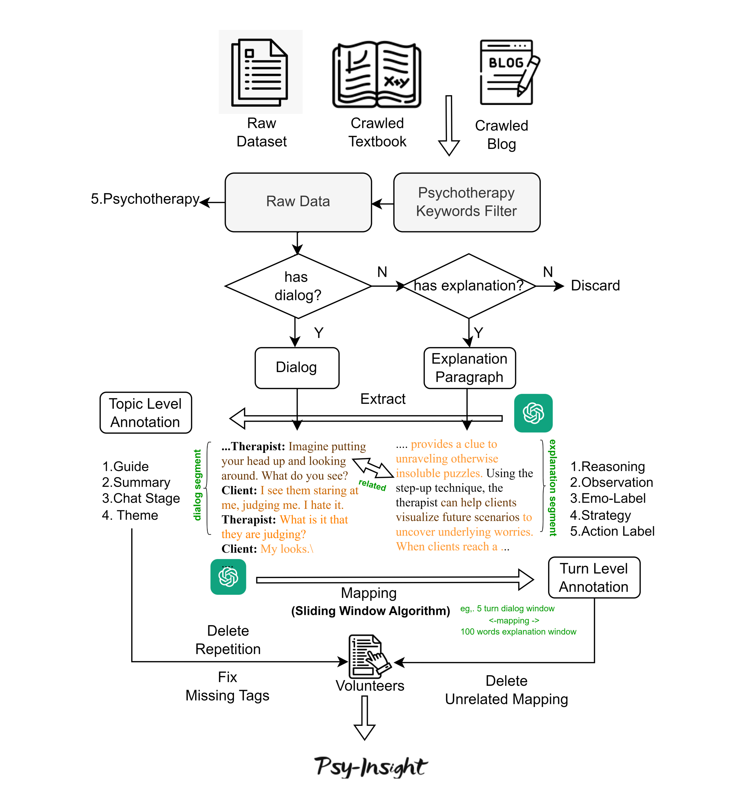

<h1 align="center">

<br>
Psy-Insight: Explainable Multi-turn Bilingual Dataset for Mental Health Counseling
</h1>

<div align="center">


</div>
<!-- https://anonymous.4open.science/r/Psy-Insight-F65E/docs/pic/ https://anonymous.4open.science/r/Psy-Insight-F65E/expert-eval/README.md-->
<p align="center">
  <a href="https://github.com/ckqqqq/Psy-Insight"><b>[🌐 Website]</b></a> • 
  <a href="https://github.com/ckqqqq/Psy-Insight/expert-eval/README.md"><b>[🐦 Human Evaluation]</b></a> • 
  <a href="https://github.com/ckqqqq/Psy-Insight/"><b>[🌐 Video]</b></a> •
  <a href="https://arxiv.org/abs/2503.03607"><b>[📜 Paper]</b></a> •
  <a href="https://github.com/ckqqqq/Psy-Insight/data/README.md"><b>[🤗 Dataset]</b></a> •
  <a href="https://github.com/ckqqqq/Psy-Insight/docs/data_source/data_source.md"><b>[⚠️ CopyRight]</b></a>
  <br>
  <!-- <a href="https://twitter.com/TODO"><b>[🐦 Twitter]</b></a> • -->
  <!-- <a href="#-quick-start">Quick Start</a> • -->
  <!-- <a href="#%EF%B8%8F-citation">Citation</a> -->
</p>


  
  
  
<p align="center">
Click Here for Detailed Introduction "<a href="https://github.com/ckqqqq/Psy-Insight/" target="_blank">Psy-Insight: Explainable Multi-turn Bilingual Dataset for Mental Health Counseling</a>"
</p>

<p align="center">
  All content in this repository is anonymous. 
</p>

## 💡 Introduction

Psy-Insight is a bilingual, interpretable multi-task dataset for psychological counseling dialogues, designed to support the application of large language models in mental health. The dataset comprises 6,208 rounds of multi-turn counseling dialogues across 520 topics in English (and 4,310 topics with 5,776 rounds in Chinese). Each dialogue round is annotated with step-by-step reasoning labels and multi-task labels. These include emotional labels (e.g., happy), psychological treatment method labels (e.g., Cognitive Behavioral Therapy CBT), strategy labels (e.g., question), and step-by-step reasoning annotations (e.g., background introduction to a dialogue topic, session summary, counselor reasoning, etc.). Psy-Insight's design is not only suitable for tasks such as emotion classification and psychological treatment interpretation but also for multi-task instruction fine-tuning of large language models.

## 🔢 Construction Workflow

<p align="center">
    
        <br>
    <em>Figure 1：Flow chart of the Psy-Insight construction pipeline.</em>
</p>

<!-- 
Flow Chart of Psy-Insight Construction
code2024/Psy-Insight/docs/images/overview/Data_Collection.png -->

<p align="center">
    
        <br>
    <em>Figure 2: Comparison of construction pipeline between short-label annotations and chain-of-thought (COT) annotations.</em>
</p>

## 📊 Data Example

A counseling cycle for a client consists of several sessions. In each session, the counselor and the client engage in multiple turns of conversation around a specific theme or goal. We annotate these two dialogue granularities with short labels and COT annotations.

### 🔧 Session-level Annotations

- | Label           | Type                     | Meaning                                                                                                                  | Example                                                                                                                                                                                                                                                                                                                                                                                                                                                                                                                                                                                                                                    |
  | --------------- | ------------------------ | ------------------------------------------------------------------------------------------------------------------------ | ------------------------------------------------------------------------------------------------------------------------------------------------------------------------------------------------------------------------------------------------------------------------------------------------------------------------------------------------------------------------------------------------------------------------------------------------------------------------------------------------------------------------------------------------------------------------------------------------------------------------------------------ |
  | dialog_id       | Short Label              | ID for this session                                                                                                     | 000001                                                                                                                                                                                                                                                                                                                                                                                                                                                                                                                                                                                                                                     |
  | theme           | COT annotation           | The brief summary of this                                                                                               | cognitive behaviour therapy: exploring cognition through images and thoughts in therapy to uncover emotionally charged thoughts and beliefs.                                                                                                                                                                                                                                                                                                                                                                                                                                                                                               |
  | psychotherapy   | short label              | The psychotherapy used by the counselor in this session                                                                  | Cognitive Behaviour Therapy / Solution-Focused Brief Therapy / Psychoanalytic Therapy                                                                                                                                                                                                                                                                                                                                                                                                                                                                                                                                                     |
  | topic           | short label              | The topic label of this session                                                                                        | Appearance Anxiety / Partner Relationship / Job Crisis / Academic Pressure                                                                                                                                                                                                                                                                                                                                                                                                                                                                                                                                                                 |
  | stage           | short label             | The stage of counseling session in the overall treatment cycle                                                           | 1st Session (the first meeting between the patient and the therapist.) / 6th to 31st Session / Regular Session                                                                                                                                                                                                                                                                                                                                                                                                                                                                                                                            |
  | guide           | COT annotation          | The brief step-by-step guide for therapists, covering the client's situation and the corresponding therapist's strategy | 治疗师通过多模式评估全面了解来访者的问题，制定个性化的治疗计划。在治疗中，她可通过行为测量、行为预演和角色演练等技术来处理问题，并逐步改变自我认知加强的信念。                                                                                                                                                                                                                                                                                                                                                                                                                                                                             |
  | is_same_qa      | short label              | Is the first response in this session consistent with the final one from the previous session?                           | 1                                                                                                                                                                                                                                                                                                                                                                                                                                                                                                                                                                                                                                          |
  | is_same_session | short label              | Is this session consistent with the previous one                                                                         | 0                                                                                                                                                                                                                                                                                                                                                                                                                                                                                                                                                                                                                                          |
  | background      | COT annotation          | background of the client in this session                                                                                 | A client struggles with feelings of guilt and inadequacy related to not having a traditional job.                                                                                                                                                                                                                                                                                                                                                                                                                                                                                                                                          |
  | reasoning       | COT annotation          | Step-by-step reasoning about the session from therapist                                                                 | The therapist's suggestions can stimulate productive introspection in the client, but an excess of suggestions may lead to client passivity. It is important for the therapist to assess the client's response to suggestions to ensure genuine progress in therapy. Additionally, suggesting opposite thoughts can help clients explore their automatic thoughts and underlying beliefs.                                                                                                                                                                                                                                                  |
  | dialog          | counseling session unit | Dailog Unit                                                                                                              |                                                                                                                                                                                                                                                                                                                                                                                                                                                                                                                                                                                                                                            |
  | summary         | COT annotation          | Step-by-step summary about the sessions from therapist                                                                 | 来访者和我讨论了找到一个完全为她自己所用的时间对她而言有多么的困难。我特别强调这也是个好机会——她可以学着向别人索取自己的所需，并坚持到底直到得到满意的结果。这样她就同时完成了另外一个目标——向别人索取自己所需要的东西。学会说“不”来访者告诉我，她到目前为止一直在不停地为每个人付出，但是她却无法为自己要求些什么。我们已经对后面这个问题进行了处理，并且获得了一定的成功。来访者告诉我，当别人要求她参与到某个活动中时，她不知道该如何拒绝，尤其当别人说他们需要她的时候，她更不知道如何说“不”。她希望能谈论她的父亲，她认为是父亲让自已失去自主权的。我要求她回忆最近一次她觉得无法拒绝别人的情况，并将这个场景详细地描述出来。 |

  ### 🔨 Turn-level Annotations in counseling session unit
- | Label           | Type             | Meaning                                                    | Example                                                                                                                                                                                                              |
  | --------------- | ---------------- | ---------------------------------------------------------- | -------------------------------------------------------------------------------------------------------------------------------------------------------------------------------------------------------------------- |
  | speaker         | short label     | Identity of speaker                                       | "seeker" or "supporter""                                                                                                                                                                                            |
  | participant     | short label      | The term used for the speaker in counseling conversations. | "Therapist"/\"Carl"\"/"Beth"/"Dr. Ralph."/"Husband"/"Bob"                                                                                                                                                            |
  | content         | dialog utterance | The content of counseling conversation                  | 我觉得你这个决定有一定道理，不过呢，就像在之前治疗里那样，每下一 款商品个结论，我们都要给个机会来验证它一下。你想要什么时候停止呢？/ How and on what basis was the decision made to end or interrupt the treatment? |
  | strategy        | short label      | The strategy of therapist                               | Question / Information                                                                                                                                                                                              |
  | emotional label | short label      | The emotion of client                                   | Anxiety / Neural / Happiness                                                                                                                                                                                         |
  | reasoning       | COT annotation   | The step-by-step reasoning from therapist                  | The therapist is inquiring about the circumstances surrounding the termination of Miss Banks' therapy with Dr. Ralph to gain insight into her treatment progress and any unresolved issues.                          |
  | observation     | COT annotation   | The summary of client utterance                            | Miss Banks expresses uncertainty and skepticism about continuing therapy, influenced by discussions with friends and her past doubts.                                                                                |

### 🔢 Target Tasks

<p align="center">
    
        <br>
    <em>Figure 3: The target tasks for the Psy-Insight dataset are as follows: Label Classification, Retrieval Argument Generation, Explainable Counseling Dialogue Generation, Counseling Summarization and so on.</em>
</p>

### 📝 Example data unit of a session

```json
{
  "theme": "solution-focused brief therapy: building trust in the therapeutic relationship through acceptance and support for students sharing their experiences.",
  "psychotherapy": "Solution-Focused Brief Therapy",
  "topic": "Child-Parent Relationship Issues",
  "stage": "",
  "guide": "",
  "is_same_qa": 0,
  "is_same_session": 0,
  "background": "A student confides in the therapist about a disturbing experience with her uncle and her concerns about her mother's reaction.",
  "reasoning": "The student's willingness to share her experience may indicate that the therapist's acceptance and support have built trust in the therapeutic relationship.",
  "dialog": [
    {
      "speaker": "Seeker",
      "participant": "Beth",
      "content": "It’s my older uncle … He comes over a lot and stays with us, and sometimes my mom leaves us with him when she goes out. I liked him, but last semester he stayed over and he wanted to kiss me. I didn’t know what to do. My mom likes him a lot, and they are close. Now, he says he loves me, and he has put his hands on me, you know, my breasts. I just stood there and didn’t know what to do. I don’t want to let mom know; she would be mad at me.",
      "id": "98-0",
      "observation": "Beth discloses a distressing experience involving her uncle, expressing confusion and fear about the situation and concern about her mother's reaction, indicating a complex family dynamic and her reluctance to cause conflict.",
      "emotional label": ["Fear", "Shame"]
    },
    {
      "speaker": "Supporter",
      "participant": "Therapist",
      "content": "Thank you for taking the chance and trying to help your situation by sharing it with me. I understand how difficult it must have been for you keeping this secret and trying to protect your mom’s relationship with her brother. I admire your courage to take care of yourself given the very difficult situation you’ve been in. Do you have any ideas about how you would want to make this better and not have this happening?",
      "id": "98-1",
      "reasoning": "The therapist acknowledges Beth's bravery in sharing her experience and offers support while encouraging her to consider ways to improve her situation, empowering her to take control and explore solutions.",
      "strategy": ["Question"]
    },
    {
      "speaker": "Seeker",
      "participant": "Beth",
      "content": "I’m aware of child protective services. They see some of my friends and their families. I don’t want to have to leave my mom, and I don’t want her to be mad at me.",
      "id": "98-2",
      "observation": "Beth demonstrates awareness of potential support services but expresses concerns about the impact on her family dynamics, highlighting her internal conflict and the importance of maintaining her relationship with her mother.",
      "emotional label": ["Fear", "Guilty"]
    },
    {
      "speaker": "Supporter",
      "participant": "Therapist",
      "content": "I agree that you should be able to stay in your home and also to have a good relationship with your mom. You are aware of child protective services. It is their job to help protect you and any other young person. I agree with you that it is best when you stay at home and make it a safe place for you and your brothers and sisters and your mom, too. From what you have shared, it would be important to contact child protective services. I know several people there, and I would like for you to help me make this contact so that you can make your home safe. Will you help make that happen?",
      "id": "98-3",
      "reasoning": "The therapist validates Beth's desire to maintain her family relationships while emphasizing the importance of her safety, suggesting a collaborative approach to involve child protective services and ensure a safe environment for Beth and her family.",
      "strategy": ["Question"]
    },
    {
      "speaker": "Seeker",
      "participant": "Beth",
      "content": "I guess … But I’m still afraid of what mom might say and of her brother.",
      "id": "98-4",
      "observation": "Beth expresses fear of potential repercussions within her family, indicating the internal struggle she faces in balancing her safety with her relationships and the challenging decisions ahead.",
      "emotional label": ["Anxiety", "Fear"]
    },
    {
      "speaker": "Supporter",
      "participant": "Therapist",
      "content": "I understand your not wanting to upset your mom or even your uncle. It’s not an easy decision to make. What do you think would be the best way to handle this so that you don’t have to deal with your uncle’s behavior and you can feel safe?",
      "id": "98-5",
      "reasoning": "The therapist acknowledges Beth's concerns and explores her thoughts on managing the situation delicately, encouraging her to consider strategies that prioritize her safety and well-being while navigating the complexities of family dynamics.",
      "strategy": ["Question"]
    },
    {
      "speaker": "Seeker",
      "participant": "Beth",
      "content": "Do you think the service worker would help me tell my mother and help make things easier after she finds out?",
      "id": "98-6",
      "observation": "Beth's question reflects her uncertainty and concern about how to handle the situation with her mother, indicating a need for support and guidance.",
      "emotional label": ["Fear"]
    },
    {
      "speaker": "Supporter",
      "participant": "Therapist",
      "content": "I can only say that that is exactly the work they do with families in these situations. It’s important that you are safe and that your family can continue to be close. And it’s important that the worker understand what happened and then has your help in finding the best way to work with your mom. You can meet and talk with the worker here at school and help her understand the situation. Is that okay with you?",
      "id": "98-7",
      "reasoning": "The therapist acknowledges Beth's concerns and offers reassurance by explaining the role of the service worker and emphasizing the importance of safety and family relationships. By involving Beth in the process and seeking her consent, the therapist empowers her to take an active role in seeking help and support.",
      "strategy": ["Question"]
    }
  ],
  "summary": "The therapist reassures the student about involving child protective services and emphasizes the importance of ensuring her safety and maintaining family relationships. The therapist encourages the student to participate in the process of seeking help and support."
}
```

### CN Chinese Data Example

```json
{
  "theme": "Partner Relationship Issues",
  "psychotherapy": "Unknown",
  "topic": "Partner Relationship Issues",
  "stage": "6th Session",
  "guide": "治疗师的直接问询方式可能为她提供了温暖和支持。",
  "is_same_qa": 0,
  "is_same_session": 1,
  "background": "来访者是一个独居女性，可能对人际关系和自我调适能力有着较强的关注。她可能在与童年记忆和家庭情感联系的治疗中探寻自我认知和解决困难。",
  "reasoning": "治疗师做得很对，不用去等着看来访者会不会跟自已多谈一点室友的事，既然治疗师对此产生了兴趣，就不妨直接问。治疗师选择先问室友的事，而不是问论文，因为了解“室友问题”，或许能使人进一步理解来访者的初始主诉议题：在建立人际关系上遇到困难。\n在“来访者因自己公寓里凌乱而不悦”，与“她的童年记忆，以及当时她母亲抑郁发作后家里的状况”之间，治疗师可能会去尝试建立联系。尽管这之间可能会存在着某种联系，但在本节面询中，尚无证据下这个结论，所以，此刻治疗师没有理由不就其字面意涵来理解来访者。治疗师没有将来访者的思考强行纳入所谓心理动力取向的诠释模式，而是把握这个机会，去了解来访者在面对压力时的反应，了解她调适日常生活的能力。\n",
  "dialog": [
    {
      "speaker": "Seeker",
      "participant": "来访者",
      "content": "我一开始就不该找她合租，但是没办法，我需要个人来分担费用。她年纪比我小很多，而且生活理念也不同。该她分担的家务，她从来都不在乎自己是不是已经完成，也不在乎公寓里乱成什么样。我可不能那样过日子，于是我就跟她说了，结果她还不高兴了。我想她早就在另找房子了吧，现在一定是已经找到了。",
      "id": "163-0",
      "emotional label": ["Anger"],
      "observation": "因室友不分担家务且公寓凌乱而不满，表达了愤怒和无奈。",
      "reasoning": "来访者表达了对室友的不满和无奈，治疗师可以通过这些信息了解来访者的人际关系问题。"
    },
    {
      "speaker": "Supporter",
      "participant": "治疗师",
      "content": "那现在你打算怎么办呢？",
      "id": "164-0",
      "strategy": ["Question"],
      "reasoning": "引导来访者深入思考问题，帮助她找到解决问题的策略。"
    },
    {
      "speaker": "Seeker",
      "participant": "来访者",
      "content": "在我做论文的研究部门里有个女人，我想她会有兴趣跟我合租。她现在承租的公寓正在卖，无论如何，她过几月也得搬家。",
      "id": "164-1",
      "emotional label": ["Neutral"],
      "observation": "希望寻找新合租者，表达了对新合租者的期望。",
      "reasoning": "来访者正在寻找新的合租者，治疗师可以进一步了解她的期望和担忧。"
    },
    {
      "speaker": "Supporter",
      "participant": "治疗师",
      "content": "那你怎么知道你们两个合得来呢？",
      "id": "164-2",
      "strategy": ["Question"],
      "reasoning": "探究潜在问题，帮助来访者思考新合租者的适应性。"
    },
    {
      "speaker": "Seeker",
      "participant": "来访者",
      "content": "我们两个年纪接近，似乎在很多事上的观点也都一致。我们在这个部门相处蛮久了，我想应该不错。",
      "id": "164-3",
      "emotional label": ["Neutral"],
      "observation": "对新合租者的期望和信心。",
      "reasoning": "来访者对新合租者有信心，治疗师可以进一步了解她的期望和担忧。"
    },
    {
      "speaker": "Supporter",
      "participant": "治疗师",
      "content": "你在这个部门的工作性质是什么？",
      "id": "164-4",
      "strategy": ["Question"],
      "reasoning": "了解背景，帮助治疗师更好地理解来访者的工作和生活环境。"
    },
    {
      "speaker": "Seeker",
      "participant": "来访者",
      "content": "我在参与一个针对领养父母的研究。领养安置之后我做跟进随访，最初，我们对领养父母的亲职能力做过一个评定，现在我要去了解其预估的准确度。",
      "id": "164-5",
      "emotional label": ["Neutral"],
      "observation": "解释了其研究工作。",
      "reasoning": "来访者解释了她的研究工作，治疗师可以进一步了解她的工作和生活环境。"
    },
    {
      "speaker": "Supporter",
      "participant": "治疗师",
      "content": "这是你攻读博士学位的一部分么？",
      "id": "164-6",
      "strategy": ["Question"],
      "reasoning": "了解来访者的学术背景和目标。"
    },
    {
      "speaker": "Seeker",
      "participant": "来访者",
      "content": "我打算继续读书，以后拿博士学位，不过现在，我正在完成硕士论文。如果我的导师喜欢我做的研究，那么今年夏天我就能拿到硕士学位了。所以我要好好准备跟他的这次约谈。对了，要是下周我暂停一次和你见面，你会介意么？我要准备见西蒙博士，时间不够用。",
      "id": "164-7",
      "emotional label": ["Anxiety"],
      "observation": "感到学业压力和焦虑。",
      "reasoning": "来访者表达了对学业的焦虑，治疗师可以进一步了解她的压力来源和应对策略。"
    },
    {
      "speaker": "Supporter",
      "participant": "治疗师",
      "content": "面询是属于你的，你当然可以取消预约，不过我怀疑取消预约对你不是太好。",
      "id": "164-8",
      "strategy": ["Affirmation and Reassurance"],
      "reasoning": "治疗师鼓励来访者继续参与治疗，帮助她应对学业压力。"
    },
    {
      "speaker": "Seeker",
      "participant": "来访者",
      "content": "你的意思是，如果我感到太过担心或者烦恼的话，那么，在我和导师见面之前来这里谈谈，会比之后再来要好，是这样么？",
      "id": "164-9",
      "emotional label": ["Anxiety"],
      "observation": "对治疗师的建议感到困惑和焦虑。",
      "reasoning": "来访者对治疗师的建议感到困惑，治疗师可以进一步解释和澄清。"
    },
    {
      "speaker": "Supporter",
      "participant": "治疗师",
      "content": "正是。",
      "id": "164-10",
      "strategy": ["Others"],
      "reasoning": "治疗师确认了来访者的理解，帮助她更好地应对学业压力。"
    },
    {
      "speaker": "Seeker",
      "participant": "来访者",
      "content": "我想，下周我还是来吧。对于今天我告诉你的事，你有什么想法么？我想我该道歉，我今天说的尽是些鸡毛蒜皮，都是让人提不起兴趣的事，我的意思是，这些都不是心理层面上的问题。",
      "id": "164-11",
      "emotional label": ["Others"],
      "observation": "对今天的话题感到不安和歉意。",
      "reasoning": "来访者对今天的话题感到不安，治疗师可以进一步澄清和肯定。"
    },
    {
      "speaker": "Supporter",
      "participant": "治疗师",
      "content": "我一点都没有觉得无趣啊。看到你有能力应对压力情境，真令人鼓舞，而且了解这些对我来说也是重要的。",
      "id": "164-12",
      "strategy": ["Affirmation and Reassurance"],
      "reasoning": "治疗师肯定了来访者的应对能力，帮助她建立自信。"
    }
  ],
  "summary": "在“来访者因自己公寓里凌乱而不悦”，与“她的童年记忆，以及当时她母亲抑郁发作后家里的状况”之间，治疗师可能会去尝试建立联系。尽管这之间可能会存在着某种联系，但在本节面询中，尚无证据下这个结论，所以，此刻治疗师没有理由不就其字面意涵来理解来访者。治疗师没有将来访者的思考强行纳入所谓心理动力取向的诠释模式，而是把握这个机会，去了解来访者在面对压力时的反应，了解她调适日常生活的能力。\n在本次面询中，治疗师采取了多种策略来处理来访者的情绪和行为。首先，治疗师澄清了来访者的焦虑并指出其能力和潜在的成长空间，鼓励她积极参与治疗。治疗师还观察到来访者对自我认知和人际关系的困惑，理解她的需求并给予肯定和指导。此外，治疗师避免了对来访者的负面评价，而是以好奇心和理解回应她的挑战，让来访者感到被接纳和理解。治疗师的策略包括鼓励、肯定、理解和引导，以帮助来访者面对自身问题并获得成长。这些策略有助于建立积极的治疗关系，促进来访者的自我探索和改善。"
}
```

## 🔢 Statistics

### Dialogue

<p align="center">
    
        <br>
    <em>Figure 4 Statistics of Chinese (left) and English (right) Counseling in Psy-Insight. In Psy-Insight, dialogues are organized in a hierarchical manner, starting from the broadest level (Case) down to the most specific (Turn). During the entire counseling process for a particular case, the therapist conducts a session centered around a specific topic. Each session includes dozens of dialogue turns. </em>
</p>

### Turn-Level Annotations

<!-- /home/ckqsudo/code2024/Psy-Insight/docs/images/statistics/Turn-level.png -->

<p align="center">
    
        <br>
    <em>Figure 5 Statistics of turn-level labels. </em>
</p>

### Session-Level Annotaions

<p align="center">
    
        <br>
    <em>Figure 6: Distribution of Sessions by Psychotherapy Type </em>
</p>

<!-- code2024/Psy-Insight/docs/images/statistics/Topic.png -->

<p align="center">
    
        <br>
    <em>Figure 7: Distribution of Sessions by Topic Type </em>
</p>

## ⚖️ Evaluation And Result


### Automatic Evaluation

<p align="center">
    
        <br>
    <em>Figure 8: Result for finetuning LLMs with different combinations of annotations. The mix-instruction chatbot is trained by performing instruction-tuning on multiple tasks simultaneously. </em>
</p>

### Human Psychotherapist Evaluation


<a href="https://github.com/ckqqqq/Psy-Insight/expert-eval/README.md"><b> [🌐 Human Expert Evaluation] </b></a> •


<!--  -->
### Evaluation Code

<a href="https://github.com/ckqqqq/Psy-Insight/auto-eval/README.md"><b> [🌐 Code] </b></a> •

## ☕️ Citation

If you find this repository helpful, please consider citing our paper:

```
@misc{ goodluck

}
```
